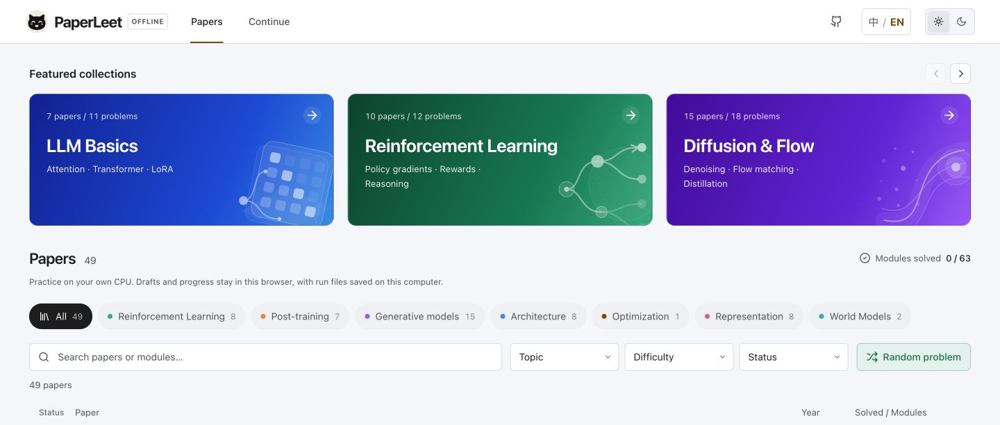
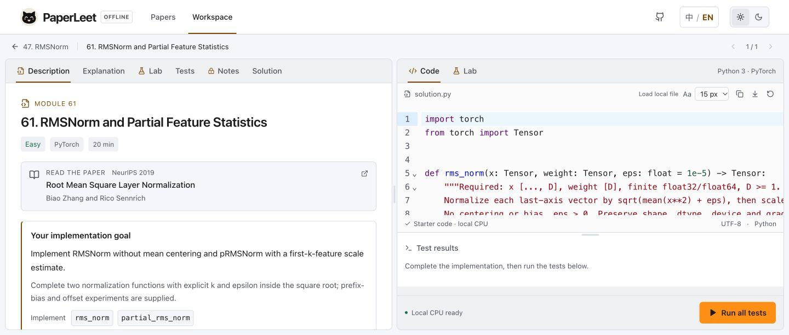

Understanding a machine learning paper on the page is very different from writing the code yourself. Practical details like tensor shapes, normalization axes, and gradient flow usually only click once you implement them.

**PaperLeet** is an open platform where researchers practice implementing ML papers like LeetCode problems, discuss solutions, share interview questions, and collaborate on conference rebuttals.

- **Website:** [paperleet.com](https://paperleet.com/)
- **Open-source offline edition (MIT):** [github.com/Hongyang-Du/PaperLeet](https://github.com/Hongyang-Du/PaperLeet)

[{: .border .rounded-sm}](/assets/images/blog/paperleet-library.jpg)

## From Paper to Code

Each paper is broken down into small modules, with one core component per module. For example, the Transformer paper is split into scaled dot-product attention, multi-head attention, LayerNorm, sinusoidal positional encoding, and the feed-forward network.

Each module gives you the problem description, input and output tensor shapes, and the functions you need to complete. Surrounding boilerplate like training loops and data helpers is already provided so you can focus on the core method. You write Python directly in the workspace, run the tests, and get clear feedback when a check fails.

[{: .border .rounded-sm}](/assets/images/blog/paperleet-workspace.jpg)

- **Runs on a CPU.** Everything runs directly in your browser on the website, or locally in PyTorch with the offline edition. No GPU is needed.
- **Learning paths.** Papers are organized into topic collections such as LLM Basics, Reinforcement Learning, Diffusion & Flow, Post-training, World Models, and Visual Generation.
- **Interactive Lab.** Modules include interactive demos and toy experiments so you can see how changes in your code affect loss curves, distributions, or gradients.
- **Notes and reference solutions.** Passing a module unlocks notes on common mistakes alongside a clean reference implementation for comparison.
- **English and Chinese.** You can switch the interface, problem statements, and explanations between English and Chinese at any time.

## Four-Layer Testing

In ML code, bugs often fail silently without crashing. You can normalize along the wrong axis, accidentally detach a gradient, or flip a sign and still get reasonable-looking numbers. To catch these subtle issues, PaperLeet checks each submission across up to four levels:

| Layer | What it checks | Typical tests |
| --- | --- | --- |
| **T0 · Contract** | Are output shapes and data types valid? | Shapes, dtypes, masks, edge-case inputs |
| **T1 · Reference** | Does the output match the reference code? | Numerical closeness within a set tolerance |
| **T2 · Properties** | Do key mathematical properties hold? | Symmetries, identities, limiting cases, gradient flow |
| **T3 · Behavior** | Does the method work in a toy experiment? | Small training, sampling, retrieval, or planning runs |
{: .table .table-sm .table-bordered}

When a check fails, it explains which property broke and compares your output against the expected values. Each problem's test suite is also verified against common buggy implementations, such as centering the input in RMSNorm or placing `eps` outside the square root. After solving a module, you can inspect those buggy examples to see what common mistakes look like in code.

## Community and Interviews

Signing in syncs your code drafts across devices and saves your submission history.

- **Discussions.** Every module has a discussion board where members ask questions, share alternative implementations, and suggest new papers to add.
- **Interview hub.** Users share real ML interview experiences tagged by company, role, interview round, and tested concepts. PaperLeet aggregates these posts by company and topic, linking each concept directly to the modules where you can practice coding it.

## Rebuttal Hub

The [Rebuttal Hub](https://paperleet.com/#/rebuttal) is a shared workspace for writing conference rebuttals with co-authors. It keeps reviewer questions, planned experiments, logged results, and point-by-point replies organized in one place:

- **Shared workspaces.** Create a workspace for each submission, invite co-authors by email or link as editors or viewers, and archive it once the rebuttal period ends.
- **Review import.** Paste raw text or import TXT, Markdown, or OpenReview JSON files. The tool splits each review into individual questions while keeping the exact reviewer quotes.
- **Progress overview.** Track each reviewer's score, summary, and completion status for both experiments and written replies.
- **Experiment tracking.** Record protocols, owners, metrics, and final numbers under each reviewer concern so every reply points to concrete results.
- **Drafting and export.** Write replies with math and Markdown preview, check word or character counts, save version snapshots, and copy clean Markdown directly into OpenReview.
- **Optional AI tools.** Summarize reviews in English or Chinese, suggest experiment plans, or shorten and polish drafts. Generated drafts only cite experiment numbers you have actually logged and mark missing evidence as `TODO`.

The workflow builds on ideas from [RebuttalStudio](https://github.com/runtsang/RebuttalStudio).

## Get Started

Pick any paper at [paperleet.com](https://paperleet.com/) to start coding in your browser. If you prefer practicing locally with native Python and PyTorch (no account needed), clone the [offline edition on GitHub](https://github.com/Hongyang-Du/PaperLeet). Paper requests, bug reports, and contributions are always welcome.
